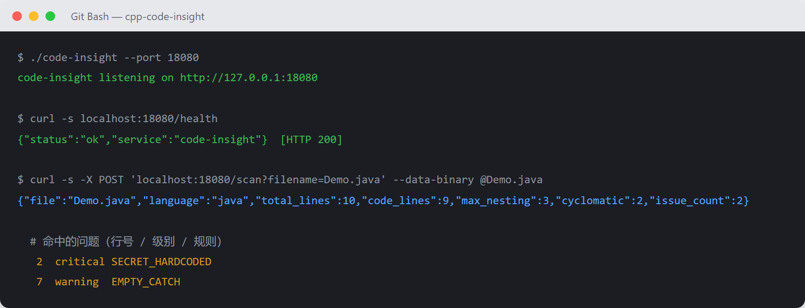
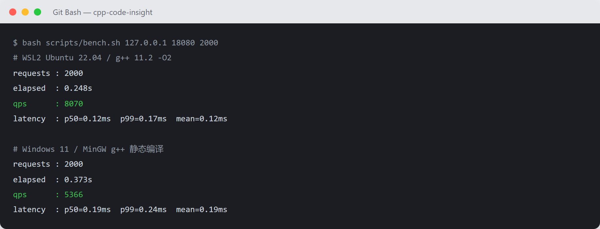

# code-insight

一个用 C++17 写的高性能代码分析服务，作为 **AI Code Review Agent 的本地工具后端**：Agent 负责编排和自然语言汇报，重计算的部分（静态扫描、重复代码检测）交给它。

不依赖任何第三方库（只用标准库 + 系统 socket API），单文件可执行。

## 这个项目解决什么

代码评审 Agent 的一个现实问题是：把整段 diff 丢给大模型，既贵又慢，而且很多问题（硬编码密钥、空 catch、SQL 拼接）用规则就能查出来，根本不需要模型。

所以拆成两层：

```
Agent（Java/Spring Boot）  --HTTP-->  code-insight（C++）  -->  规则命中 + 统计指标
        |                                    |
    自然语言报告                     正则/结构分析/复杂度
```

Agent 把工具调用当做一个 function，拿到结构化结果后再组织语言。这样既省 token，也让"哪些问题是规则查的、哪些是模型判断的"边界清晰。

## 设计要点

**跨平台事件轮询。** Linux 走 `epoll`，Windows 走 `WSAPoll`，通过 `Poller` 接口抽象，上层 Reactor 与平台无关。

```cpp
class Poller {
    virtual bool add(socket_t, Event) = 0;
    virtual bool modify(socket_t, Event) = 0;
    virtual bool remove(socket_t) = 0;
    virtual int wait(std::vector<Ready>&, int timeout_ms) = 0;
};
```

**单线程 Reactor + 非阻塞 IO。** 所有连接在一个事件循环里处理，读写都是非阻塞的；写缓冲没发完就挂 `Writable` 事件等下次可写，不阻塞循环。

**请求流水线支持。** 一次 `read` 可能收到多个完整请求，处理时循环解析直到数据不足。

**零拷贝解析。** HTTP 解析直接在接收缓冲区上做，只对 body 做一次拷贝，避免多次拼接。

## 接口

| 方法 | 路径 | 说明 |
|---|---|---|
| GET | `/health` | 健康检查 |
| POST | `/scan?filename=Demo.java` | 扫描一段代码，返回行数、注释比、嵌套深度、圈复杂度、问题列表 |

请求体就是代码原文，`filename` 只用于判断语言和回显。

响应示例：

```json
{
  "file": "Demo.java",
  "language": "java",
  "total_lines": 7,
  "code_lines": 6,
  "max_nesting": 2,
  "cyclomatic": 2,
  "issue_count": 2,
  "issues": [
    {"rule": "SECRET_HARDCODED", "severity": "critical", "line": 3,
     "message": "疑似硬编码凭据，应改为环境变量或配置中心",
     "snippet": "String password = \"hardcoded123\";"},
    {"rule": "EMPTY_CATCH", "severity": "warning", "line": 4,
     "message": "空 catch 块会吞掉异常，至少应记录日志"}
  ]
}
```

## 内置规则

| 规则 | 级别 | 检测内容 |
|---|---|---|
| `SECRET_HARDCODED` | critical | 硬编码的密码 / token / api key |
| `SQL_CONCAT` | critical | SQL 由字符串拼接构造（注入风险） |
| `C_DANGEROUS_FUNC` | warning | `strcpy` / `sprintf` / `gets` 等不安全函数 |
| `EMPTY_CATCH` | warning | 空 catch 块 |
| `DEBUG_RESIDUE` | warning | 调试输出残留（`console.log` / `System.out.println`） |

## 构建

```bash
# Linux
cmake -B build && cmake --build build -j
./build/code-insight --port 18080

# Windows (MinGW)
g++ -std=c++17 -O2 -static -Iinclude src/*.cpp -o build/code-insight.exe -lws2_32
```

## 命令行单文件扫描（不起服务）

CI 里往往只想"扫一个文件、拿到结果、按条数决定过不过"，起个 HTTP 服务再调接口太重。所以加了一个直接扫描模式：

```bash
./code-insight --scan src/http.cpp            # 人看的摘要
./code-insight --scan src/main.cpp --json     # 机读，接 CI
# {"file":"src/main.cpp","language":"cpp","lines":184,"codeLines":150,...,"critical":0,"warning":0,"issues":[]}
./code-insight --scan                        # 参数缺失：报用法并以 2 退出，不会退化成起服务
```

`--scan` 后面必须跟文件路径。路径缺失或为空串时直接 `error: --scan 需要文件路径` 并退出 2——
这样脚本里 `--scan $FILE` 的变量没赋值时能立刻失败，而不是静默落回服务模式把一个前台进程挂在 CI 里。
`--scan-dir` 同理（`error: --scan-dir 需要目录路径`），拼错的选项（`--ports`）和多写的参数一律
`error: 未知选项` 退 2；`--port` 只接受 1..65535 的整数，写成 `abc` 或 `70000` 会退 2，
不会再被 `atoi` 悄悄变成端口 0 随机开一个。

**退出码 = critical + warning 的条数**（封顶 125，避免被 shell 截断成 0），所以可以直接写进流水线：

```bash
if ! ./code-insight --scan src/foo.cpp --json > report.json; then
  echo "有告警，按 report.json 处理"; fi
```

同一个 `scan()` 函数既供 HTTP 接口用也供命令行用，不存在两份逻辑：

```
$ ./code-insight --scan /tmp/bad2.cpp
行数 7（代码 6 / 注释 1）  最大嵌套 1  圈复杂度 1  TODO 0
问题 2 条：critical 1 / warning 1
  [critical] SECRET_HARDCODED:4  疑似硬编码凭据，应改为环境变量或配置中心
  [warning ] C_DANGEROUS_FUNC:5  使用了不安全的 C 字符串函数，建议改用带长度限制的版本
$ echo $?
2
```

### 扫整个目录

单文件扫描只够看一个文件，CI 里要的是「这个仓有多少问题」。所以还有目录模式：

```bash
./code-insight --scan-dir src            # 递归扫，按扩展名过滤
./code-insight --scan-dir . --json       # 机读，退码=问题总数
```

```
扫描目录 .
  文件 12 个，971 行；跳过无法打开 0 个
  问题：critical 0 / warning 0
```

会递归遍历目录，只认 `.c/.cc/.cpp/.h/.hpp/.java/.py/.js/.ts/.go` 这些扩展名，
汇总文件数、总行数、critical/warning 数，并列出"有问题的文件"（最多 30 个，超出只报数量）。
**退码 = critical + warning**（封顶 125），所以直接写进流水线：

```bash
./code-insight --scan-dir src || echo "有告警，见输出"
```

子目录读不了（权限不足、扫到一半被删）时只跳过它并计数，输出多一行

```
  另有 2 个目录读不了，已跳过
```

JSON 里对应 `"skippedDirs":2`。此前这种情况会抛 `std::filesystem::filesystem_error`
直接 terminate，整棵树一条结果都出不来，扫带系统目录的大树必踩。

扫描自身是干净的（12 个文件 971 行，0 条），这也是这个小工具能自己检查自己的原因。

## 压测

```bash
./scripts/bench.sh 127.0.0.1 18080 2000
```

脚本用一个长连接连发 2000 个 `/scan` 请求，输出 QPS 与 P50/P99。换成 `wrk -t4 -c200 -d10s --latency` 可以测并发连接下的表现。

## 运行效果

以下为命令的实际输出（终端渲染）：



`/scan` 返回结构化结果：行数、嵌套深度、圈复杂度，以及命中问题的行号与级别。



同一份代码在两个平台各压一次，单连接 2000 次请求。

## 性能

单连接 keep-alive 连续请求，2000 次 `/scan`，同一份代码、同一台机器，两个平台各跑一次：

```text
WSL2 Ubuntu 22.04 / g++ 11.2 -O2
requests : 2000
elapsed  : 0.248s
qps      : 8070
latency  : p50=0.12ms  p99=0.17ms

Windows 11 / MinGW g++ 静态编译
requests : 2000
elapsed  : 0.373s
qps      : 5366
latency  : p50=0.19ms  p99=0.24ms
```

差 50% 主要来自网络栈：Windows 的 loopback 与 socket 实现开销更高，同一份代码在 Linux 上更快。这也说明**报性能数字必须带上环境**，否则没有可比性。

说明几个前提，避免误读：

- 这是**单连接串行**的成绩，测的是"单个请求处理有多快"，不是并发吞吐
- 请求体是 10 行的短文件，正则逐行匹配的开销小；代码越长、规则越多，耗时会线性增长
- 瓶颈主要在正则匹配，不在网络层——换成并发后 QPS 会明显下降

并发场景用 wrk 另测：

```bash
wrk -t4 -c200 -d10s --latency http://127.0.0.1:18080/health
```

## 已知限制

- 圈复杂度是简化的关键字计数，不是完整的 AST 分析
- 正则逐行匹配，跨行问题（比如多行 SQL 拼接）查不出来
- 没有 TLS，生产环境需要前置反向代理
